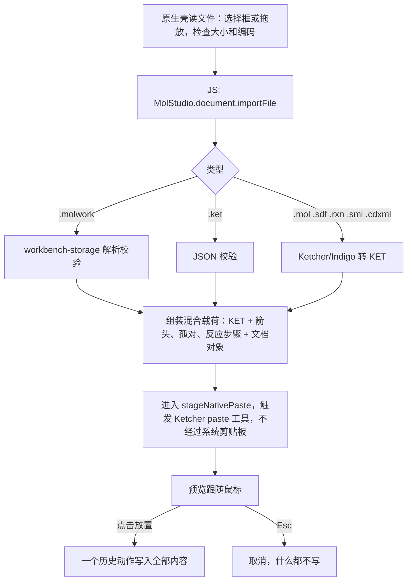

# 纸页模式与欢迎页：设计与实现方案

状态：**共享画布混合编辑已实现，本机构建验收完成**（2026-11-14）。本文记录设计与后续目标；当前功能和各构建的实际验收结果见 [实现与验收记录](DOCUMENT_MODE_RESULTS.md)。功能表和阶段表中的后续条目不代表已经交付。

本轮先证明 A4 页上直接编辑化学结构与电子流、文字/图片/形状混排、联合选择与移动、统一撤销、缩放命中、保存重开及按页 PDF。欢迎页作为独立组件并行开发，不能阻塞这个闭环。旧文档原型与 `.molnote` 保持原状；是否迁移、如何发布另行决定，本方案不改变根 AGENTS 的本地/GitHub 范围限制。

## 1. 目标与范围

把文档功能直接做进当前画布（`canvas.html`），不再把画布内容以快照的形式嵌进纸页。

- 整个文档就是一张画布。结构、孤对电子、弯箭头、文字、图片、形状都在同一个坐标系里，机理在纸上直接编辑，不需要弹窗或切换模式。
- 两种模式：**无边画布**（现状）和**纸页**（A4/Letter 等，带页边界，可增删页，按页导出 PDF）。
- 文字、图片、形状两种模式都能用。纸页模式只额外增加页面设置、页边界和分页导出。建好之后可用画布上方的“页面”按钮切换。
- 欢迎页改用 SwiftUI 重写，在欢迎页直接选择新建画布或纸页。
- 页面纵向排列。文字只做自由文本框，**不做**跨页自动流动的长正文。
- 本地原型 `research/document-editor-prototype/`（board、`.molnote`）本轮不迁移、不整理，保留独立应用及文件；按需复用其 `shared/` 能力，不复制整个 board 引擎。

### 决策记录

| 事项 | 结论 |
| --- | --- |
| 文档形态 | 画布 + 纸页层（ChemDraw 式），不做"纸里嵌画布" |
| 页面排列 | 纵向连续 |
| 文字形态 | 自由文本框，不做跨页流动正文 |
| 文件格式 | `.molwork` 增加可选 `document` 段；带该段写 v2，纯画布仍写 v1 |
| 导入内容超出页宽 | 本轮原样放置并保留源几何；按页宽重排与缩小放置留待后续，超出页面不自动裁改源内容 |
| `.molnote` | 本轮保留原应用和原文件，不迁移；后续兼容策略另定 |
| 欢迎页技术 | SwiftUI（`NSHostingView`） |
| GitHub 公开范围 | **待定**：直接进 `main`，或先放在功能开关后面 |

## 2. 可直接借用的现有能力

| 现有能力 | 位置 | 用途 |
| --- | --- | --- |
| 机理层是插在 Ketcher 画布 svg 里的 `<g>`，用结构坐标绘制，缩放平移自动跟随 | [ketcher-adapter.js](workbench/ketcher-adapter.js) `ensureLayer()`、[mechanism-layer.js](workbench/mechanism-layer.js) | 纸页层、文档层照这个模式实现 |
| 机理操作写进 Ketcher 自己的撤销历史 | `adapter.pushAction`、[mechanism-controller.js](workbench/mechanism-controller.js) `wrapNativeHistory` | 文档层写进同一个栈，撤销自然统一 |
| 分子与箭头的混合粘贴：分子由 Ketcher PasteTool 放置，箭头按同样的位移、缩放、旋转跟随，合成一个历史动作 | `mechanism-controller.js` `stageNativePaste` / `startNativePaste` | 文件插入走这条路（第 7 节） |
| 路线排版已有 `maxRowWidth` 和行间换行（"续 1"） | [reaction-graph-layout.js](workbench/reaction-graph-layout.js) | 纸页模式传入页面内容区宽度 |
| 单图导出 | [mechanism-export.js](workbench/mechanism-export.js) | 单页 SVG/PNG、欢迎页缩略图 |

## 3. 坐标与比例

- 全文档只有一个坐标系：Ketcher 的结构坐标，1 单位 = 1 个键长。
- 印刷比例固定为 **1 键长 = 14.4 pt**（ACS 1996 标准键长）。
  - A4 是 595.28 × 841.89 pt，即 41.34 × 58.46 单位。
  - 页边距 20 mm ≈ 56.7 pt ≈ 3.94 单位。
- 每页拥有稳定 ID；第 i 页的原点为 `(0, i × (页高 + 页间距))`，页间距 2 单位。页序与物理尺寸决定矩形，但不以数组下标作为页面身份。显式页归属和草稿区内容要能区分。
- 新增、删除、改纸型必须是可撤销事务。删除中间页时明确处理该页内容及后续页位移，同时移动分子、孤对、电子流、反应步骤和文档对象；不能只改 `pageCount` 或悄悄裁掉对象。第一轮先允许安全地增加/删除空白尾页，未完成的中间页重排不暴露为可用功能。
- 显示比例：Ketcher 默认 1 单位 = 40 px，页面以实际大小显示（794 px 宽）时 zoom ≈ 0.48，UI 上的"100%"对应这个 zoom。
  - [canvas-viewport.js](workbench/canvas-viewport.js) 的 zoom 下限要从 0.2 放宽到约 0.08，才能看到多页总览。Ketcher 内部是否还有下限钳制，由探针确认。

**风险（探针第一项）**：[main.js](workbench/main.js) 的注释指出，`setMolecule` 会重新居中或缩放导入的 KET。打开文件后，页面和文档层必须与原子做完全相同的变换，否则会错位。

- 首选方案：载入时让 Ketcher 保持文档持久坐标，视口平移缩放仅影响显示。原子、机理和文档层共用适配器中的显式坐标变换；KET 的 y 轴与运行时结构坐标的转换不能混用。
- 退路：只有在真实探针证明变换一致且可逆时，才可使用 bindings 对应关系处理导入变换；不能靠事后拟合掩盖不稳定的文档坐标。P0 分别覆盖无原子纯文字、单原子、多片段、手动缩放化学内容和重新打开。

## 4. 纸页层

- 在 Ketcher 画布 svg 里放 `<g id="molstudio-page-layer">`，固定为 svg 的**第一个子节点**，位于所有化学内容下方。Ketcher 重绘后由现有的 svg 观察器把它挪回原位。
- 层内绘制：桌面灰底、纸张矩形和阴影、页边距虚线（只在编辑时显示）、页码。整层打上 `data-mech-ui` 标记，导出时排除，纸张底色在导出时另行生成。
- 页外区域是草稿区：可以放内容，但不打印，导出前给出提示。
- 拖动对象时吸附到页边距和页中线。内容超出最后一页时，状态栏提示"新增一页"，不自动加页。
- 左侧页面缩略栏可折叠：克隆 svg，设置每页的 viewBox，低分辨率渲染，编辑后延迟约 500 ms 再刷新。
- 状态栏显示"第 n / N 页"和"适合页面 / 适合宽度"。纸页模式下滚轮纵向滚动，平移范围限制在全部页面外加一圈边距内。

## 5. 文档层（文字、图片、形状）

### 5.1 用自己的层，不用 Ketcher 原生对象

KET 本身支持 `text`、`image`、`simpleObject`，但不够用：文本没有字体族、段落对齐和公式；形状没有填充和描边样式；图片不能裁剪。因此文档层由 MolStudio 自己管理，但按机理层的模式接入 Ketcher：

| 方面 | 做法 |
| --- | --- |
| 渲染 | `doc-back`（图片、形状）位于纸页层之上、化学内容之下；`doc-front`（文本框、标注）位于机理层之上 |
| 选择 | 与现有"分子 + 箭头联合选区"一致：框选同时选中分子、箭头、文档对象，一起拖动、删除、复制 |
| 历史 | 每个操作调用 `adapter.pushAction(undo, redo)` 写进 Ketcher 历史；与分子一起移动时合并成一个动作 |
| 工具 | 工具栏加"文字 / 图片 / 形状"组，隐藏 Ketcher 自带的文本、形状、图片工具；已有 KET 中的原生 text/image 照常显示 |

### 5.2 对象类型

- **文本框**
  - 显示用 SVG `foreignObject` 包 HTML。
  - 双击进入编辑：在同一位置叠一个按 zoom 缩放的 `contenteditable`，提交后写回模型。
  - 支持字体、字号、粗斜、上下标、颜色、对齐、行距、公式、Markdown。
  - 退路：若 `foreignObject` 在 WKWebView 的 PDF 输出中不可靠，改为 SVG `<text>/<tspan>` 渲染。
- **图片**
  - 拖框插入，支持裁剪、旋转、替换。
  - 长边超过 2400 px 时降采样，可选保留原图。
- **形状**
  - 矩形、圆角矩形、椭圆、线、普通箭头（非电子流）、多边形、方括号。
  - 可设置描边、填充、线型。
- 右侧属性面板按选中对象的类型切换内容。
- 可参考的原型模块：`rich-text`、`formula`、`markdown`、`shapes`、`image-transforms`、`font-catalog`、`inspector`、`print-rules`。搬运时去掉对 board 引擎的依赖。

## 6. 文件格式

```jsonc
{
  "format": "molstudio-workbench",
  "version": 2,              // 只有带 document 段才写 2；纯画布仍写 1
  "ket": {},                 // 以下现有字段不变
  "bindings": {},
  "mechanism": {},
  "reactionSteps": [],
  "document": {
    "mode": "paper",         // "canvas" | "paper"
    "page": { "size": "A4", "orientation": "portrait",
              "width": 595.28, "height": 841.89,
              "margins": { "top": 56.7, "right": 56.7, "bottom": 56.7, "left": 56.7 } },
    "ptPerBond": 14.4,
    "pageCount": 3,
    "pages": [{ "id": "page-1" }, { "id": "page-2" }, { "id": "page-3" }],
    "objects": [
      { "id": "obj-…", "kind": "text",  "band": "front", "x": 3.9, "y": -4.0, "w": 20, "h": 3, "rotation": 0, "rich": {} },
      { "id": "obj-…", "kind": "image", "band": "back", "asset": "sha256-…", "crop": {} },
      { "id": "obj-…", "kind": "shape", "shape": "rect", "stroke": {}, "fill": "#ffffff" }
    ],
    "assets": { "sha256-…": { "mime": "image/png", "data": "<base64>" } },
    "regions": [ { "id": "region-…", "label": "路线 A", "x": 0, "y": 0, "w": 30, "h": 12 } ]
  }
}
```

- 文档对象与原子使用同一个 KET 坐标系保存，载入时与原子一起变换。
- [workbench-storage.js](workbench/workbench-storage.js) 需要：
  - 新增 `document` 校验：id 唯一、坐标为有限数、asset 引用存在、数量和尺寸有上限；
  - 资源单独限额（如图片合计 64 MB），现有 8 MB 总限额只计入非资源部分；
  - 旧版本遇到 v2 文件按现有 `newer_version` 逻辑明确拒绝，v1 文件照常读写。
- `regions`（方案框）是 AI 和自动排版的作用范围，界面上显示成可隐藏的虚线框。

## 7. 打开与插入外部文件

| 动作 | 入口 | 结果 |
| --- | --- | --- |
| 打开 | 欢迎页、文件 › 打开 | 新开文档，模式由 `document.mode` 决定；没有这一段的按无边画布打开（与现在一致） |
| 插入 | 插入 › 从文件…（`⇧⌘I`）、把文件拖到画布、粘贴 | 并入当前文档，整个过程算一次撤销 |

插入流程：



1. **ID 全部重新生成**：原子、键、箭头、孤对、stepId、文档对象 id 全部重映射，同一个文件插入两次也不冲突。
2. **补齐混合粘贴**：现有混合粘贴要确认并补上孤对、`reactionSteps` 和条件标签。补齐后普通复制粘贴也一起受益。
3. **放置**：
   - 拖放：放在松手位置；
   - 菜单插入：预览跟随鼠标，`Enter` 自动放到当前页第一个够大的空白处（扫描本页已有对象的外框）。
4. **超出页宽**（纸页模式）：
   - 默认**按页宽重新排版**（`maxRowWidth` 取内容区宽度，自动换行并生成"续 n"衔接标记）；
   - 也可选缩小放置（键长会偏离 ACS 比例，给出提示）或原样放置。
5. **插入一个纸页 `.molwork`**：只取内容，资源按 hash 去重合并，忽略对方的页面设置。
6. **可选：插入时生成方案框**，以后 AI 和"重新排版"只作用于这个框。
7. **不导入**：`agentTask`、视口、选区。
8. **原生壳改动**：新增"插入 › 从文件…"菜单；画布接收文件拖放后，把内容和落点（宿主坐标）交给 JS 换算成结构坐标。拖到欢迎页上的文件按"打开"处理。

## 8. 导出 PDF

1. 逐页处理：克隆 Ketcher svg，移除所有 `data-mech-ui` 交互元素，viewBox 设为该页矩形，尺寸写成纸张的物理尺寸（如 `210mm × 297mm`），补上白色纸底。
2. 参考本地文档原型已经验证的流程：对每个有界页面分别调用 `WKWebView.createPDF`，按真实纸张尺寸合并为多页矢量 PDF；不把一整张长网页交给系统自动分页。`NSPrintOperation` 在原型测试环境曾产生空页，不作为未经验证的等价替代。覆盖中文文字可选择/复制、字体、公式、图像与 SVG 叠层的真实输出。
3. 导出前检查：页外有内容、图片缺失、字体缺失，均给出提示。
4. 单页可另存为 SVG 或 PNG，复用 `mechanism-export.js`。

## 9. AI 与自动排版

- [agent-bridge.js](workbench/agent-bridge.js) 的画布上下文新增：`document.mode`、页面列表（每页内容区的结构坐标矩形）、`regions`、当前视口所在的页。
- 绘图和排版指令新增可选参数 `region` / `page`：
  - 排版只在目标矩形内进行，`maxRowWidth` 取该矩形的宽度；
  - 没给目标时，默认放到当前页的空白处。
- 内容溢出时返回"需新增页面"，由用户确认，不默认加页。
- `maxRowWidth` 只负责横向换行，不能代替页高约束。需独立计算每行/步骤的高度、目标页可用高度及续页衔接；单个分子与步骤不跨纸边裁切。未实现页高自动分配时明确报告超出区域，不声称已完成纸页排版。

## 10. 欢迎页（SwiftUI）

- 用 `NSHostingView(rootView: WelcomeView(model:))` 替换 `fusion-native/Sources/Ketcher3D/main.swift` 中 `showWelcome()` 的手写 AppKit 布局。部署目标已是 macOS 14。
- 布局：
  - 顶部是标题和搜索框；
  - 第一行三张卡：**无边画布**、**纸页**（卡片下方是可修改的默认设置，如 A4·纵向·标准边距，记住上次选择）、**打开**（内含示例下拉）；
  - 下方是最近文件，可在网格和列表之间切换。
- 视觉沿用原型设计规范的颜色、圆角、间距（`research/document-editor-prototype/DESIGN.md`），与画布保持一致。
- `WelcomeModel: ObservableObject` 提供：最近文件、新纸页的默认设置（存 `UserDefaults`）、示例列表、搜索词。按钮通过闭包调用 AppDelegate 现有方法：
  - `actNewDocument(mode:)`：`PendingPayload.newDocument` 增加 `mode` 和 `pageSetup` 参数，画布就绪后由 `applyPending` 调用 `MolStudio.document.init({...})`；
  - `actOpen`、`openDocument`、`actOpenExample(id)`；
  - 右键菜单：打开、在 Finder 中显示、重命名、从列表移除、删除。
- **最近文件**：现在只列出 `Application Support/Ketcher3D` 目录，改为每次打开或保存时调用 `NSDocumentController.shared.noteNewRecentDocumentURL`。列表合并 `recentDocumentURLs` 和 App 文件夹，去重后按修改时间排序；已不存在的文件显示为灰色，可从列表移除。继续预选上次打开的文件。
- **缩略图**：
  - 保存成功后，JS 用 `mechanism-export.js` 渲染约 480 px 的 PNG（纸页模式取第 1 页，带纸张边框），通过 `webkit.messageHandlers` 交给原生壳；
  - 原生壳写到 `Application Support/Ketcher3D/thumbnails/<sha1(path)>.png`，重命名或另存为时一并迁移；
  - 文件修改时间晚于缩略图即视为过期，过期或缺失时显示按模式区分的占位图。
- **菜单**：`⌘N` 新建画布，`⇧⌘N` 新建纸页文档，`⇧⌘H` 欢迎页（保留）。
- 副标题由"分子结构编辑与 3D 预览"改为能反映当前能力的文案。

## 11. 分阶段与验收

| 阶段 | 内容 | 关键验收 |
| --- | --- | --- |
| P0 单页闭环 | A4 上直接编辑原子/键和电子流、文字/图片/形状、混合选择/移动/删除/撤销、IME、缩放命中、坐标稳定性、单页矢量 PDF；再做5–10页性能探针 | 真正编辑而非静态预览；纯文字/单原子/多片段保存重开不错位；混合动作只需一次撤销；PDF 与屏幕一致 |
| P1 欢迎页 | SwiftUI、两种新建、最近文件、缩略图 | 原生构建截图；最近文件包含保存在 App 文件夹以外的文件 |
| P2 纸页模式 | 页面设置、增删页、缩略栏、适合页面、导出 PDF、`document` v2 | v1 文件照常打开；v2 文件在旧版本中被明确拒绝 |
| P3 文档层 | 文字、图片、形状、属性面板、联合选区、统一撤销 | 分子与文本框一起框选、拖动、撤销，结果一致 |
| P4 导入与融合 | 文件插入、补齐混合粘贴、方案框、AI 识别页面、按页宽排版 | 插入 `.molwork` 后箭头、孤对、步骤完整，一次撤销全部还原；`caffeine-routes` 在纸页内正确换行 |
| P5 验收 | 按 [AGENTS.md](../AGENTS.md) 执行 | 回归测试 + 真实模型用例；截图和可编辑样例注明应用、页面和构建 |

P0 与 P1 组件可以并行，但 P0 混合编辑是后续扩展的前置门槛。欢迎页作为独立 SwiftUI 组件开发并集成至原生外壳。若 P0 证明当前宿主无法满足坐标、性能或富文本要求，应记录具体证据后调整架构；不可直接回退为“图片预览 → 临时工作台”的交互并声称实现了直接编辑。

## 12. 落地时需同步的文档

- 根目录 [README.md](../README.md)：按实际验收状态补充当前画布的纸页模式入口；保持旧文档应用的本地范围说明。[AGENTS.md](../AGENTS.md) 与 Git/GitHub 范围不因本轮新功能自动改变。
- [fusion/README.md](README.md)：补充纸页模式的开发与测试命令。
- [agent/README.md](agent/README.md)：补充纸页模式下的 `caffeine-routes` 验收方法。
